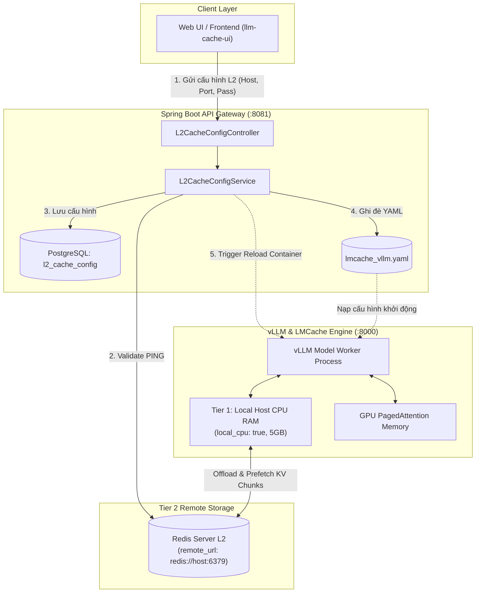
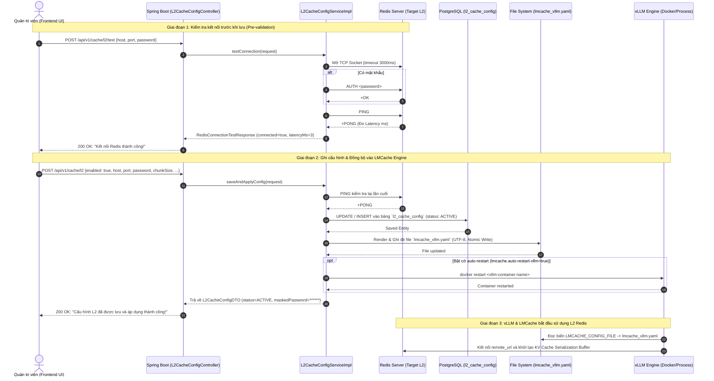
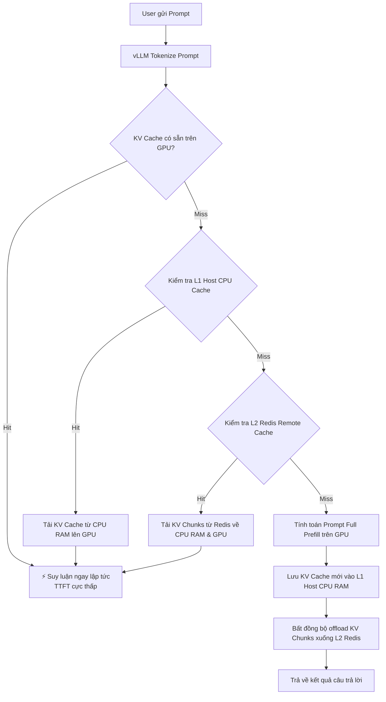

# LUỒNG TỰ ĐỘNG CẬP NHẬT CẤU HÌNH L2 CACHE VÀO LMCACHE ENGINE

Tài liệu này mô tả chi tiết kiến trúc, biểu đồ luồng dữ liệu (Data Flow), trình tự thực thi (Sequence Workflow) và cơ chế nội tại khi cập nhật cấu hình **L2 Remote Cache (Redis)** vào hệ thống **LMCache + vLLM**.

---

## 1. Kiến Trúc Phân Tầng Caching (Tiered Caching Architecture)

LMCache hoạt động theo cơ chế bộ nhớ phân cấp (Hierarchical / Tiered Memory):



---

## 2. Biểu Đồ Trình Tự Luồng Cập Nhật (Update Sequence Workflow)

Khi người dùng thao tác trên giao diện người dùng, toàn bộ chu trình xử lý diễn ra qua 6 giai đoạn nghiêm ngặt:



---

## 3. Chi Tiết Các Bước Kỹ Thuật Trong Luồng

### Bước 1: Tiền Kiểm Tra Kết Nối (Socket Pre-Validation)
- Trước khi lưu vào hệ thống, [`L2CacheConfigServiceImpl`](file:///d:/Hangout/Master/Final/llm-cache/vLLM/src/main/java/main/vllm/service/impl/L2CacheConfigServiceImpl.java) mở một socket TCP trực tiếp tới địa chỉ `host:port` với timeout 3 giây.
- Sử dụng giao thức chuẩn **RESP (Redis Serialization Protocol)**:
  1. Gửi lệnh `AUTH <password>\r\n` (nếu có mật khẩu cấu hình).
  2. Gửi lệnh `PING\r\n`.
  3. Đọc phản hồi `+PONG\r\n` và đo đạc thời gian khứ hồi (Round-Trip Time / Latency ms).
- **Lợi ích:** Tránh tình trạng người dùng nhập sai IP/Port dẫn đến việc vLLM khởi động lại bị crash do không thể kết nối tới L2 remote storage backend.

---

### Bước 2: Lưu Cấu Hình Vào Cơ Sở Dữ Liệu PostgreSQL
- Dữ liệu được lưu trữ lâu dài (persistent) trong bảng `l2_cache_config`:
  - `enabled`: Bật/Tắt L2.
  - `host`, `port`: Địa chỉ Redis server.
  - `password`: Mật khẩu kết nối.
  - `chunk_size`: Kích thước chia nhỏ KV tokens (mặc định 256).
  - `max_local_cpu_size_gb`: Dung lượng RAM dành cho L1 cache (mặc định 5.0 GB).
  - `remote_serde`: Định dạng mã hóa (`naive` hoặc `cachegen`).
  - `status`: Trạng thái vận hành (`ACTIVE`, `DISABLED`, `ERROR`).
  - `updated_at`: Thời điểm cập nhật cuối cùng.

---

### Bước 3: Tự Động Sinh & Ghi Đè File `lmcache_vllm.yaml`
- Hệ thống tự động biên dịch thực thể cấu hình thành file cấu hình YAML chuẩn của LMCache:

```yaml
# ================================================================
# LMCache Configuration File (Auto-generated by Spring Boot)
# ================================================================

# Chunk size (number of tokens per KV chunk)
chunk_size: 256

# Tier 1: Local CPU Cache
local_cpu: true
max_local_cpu_size: 5.0

# Tier 2: Remote Distributed Storage (Redis)
remote_url: "redis://:mypassword@192.168.1.50:6379"
remote_serde: "naive"
```

- Khi người dùng **Tắt L2 Cache** (qua `DELETE /api/v1/cache/l2` hoặc toggle tắt trên UI):
  File YAML sẽ tự động chú thích lại (comment out) dòng `remote_url`:
  ```yaml
  # Tier 2: Remote Distributed Storage (Disabled)
  # remote_url: "redis://localhost:6379"
  # remote_serde: "naive"
  ```
  LMCache lập tức trở về chế độ **L1 CPU Cache độc lập**, không còn phụ thuộc Redis.

---

### Bước 4: Đồng Bộ Khởi Động Lại vLLM Engine (Lifecycle Synchronization)
- Vì LMCache khởi tạo socket kết nối lưu trữ lúc khởi động vLLM worker process:
  - Nếu `lmcache.auto-restart-vllm=true`: Backend gọi lệnh `docker restart <vllmContainerName>` để container tự đọc lại file `lmcache_vllm.yaml` mới.
  - Nếu vLLM chạy dưới dạng tiến trình độc lập (Systemd service hoặc Python command), người dùng có thể kích hoạt reload service thủ công.

---

## 4. Luồng Truy Vấn & Lưu KV Cache Tại Thời Điểm Chạy (Runtime KV Flow)

Khi cấu hình L2 Redis đã hoạt động, mỗi khi người dùng gửi một lượt chat mới (`POST /api/v1/chat`):



---

## 5. Cơ Chế Xử Lý Lỗi & Rollback (Fault Tolerance)

| Tình Huống Lỗi | Cơ Chế Xử Lý Của Hệ Thống |
| :--- | :--- |
| **Sai IP/Port hoặc Redis sập trước khi lưu** | Backend chặn ngay ở bước kiểm tra `testConnection`, trả về lỗi HTTP 400 kèm thông báo chi tiết, **không ghi đè file YAML**, hệ thống vLLM tiếp tục chạy bình thường với cấu hình cũ. |
| **Redis bị ngắt kết nối đột ngột lúc runtime** | LMCache có cơ chế fallback: nếu không thể đọc/ghi L2 Redis, engine tự động chuyển sang tính toán cục bộ (Local Compute) trên GPU/L1 mà không làm gián đoạn câu trả lời chat của người dùng. |
| **Người dùng đổi mật khẩu hoặc tắt L2** | Gọi `DELETE /api/v1/cache/l2`: Hệ thống xóa `remote_url` trong `lmcache_vllm.yaml` và reload engine, chuyển hoàn toàn về Local Tier an toàn. |
